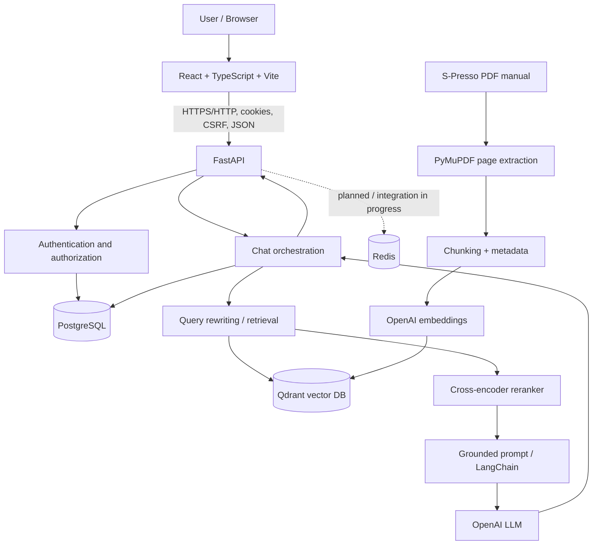

# S-Presso Warranty AI — Enterprise RAG Platform

> **Project status (22 October 2026):** Local end-to-end RAG chat, React UI, FastAPI, Qdrant retrieval, PostgreSQL-backed conversation history, and authentication have been implemented and tested during development. The PostgreSQL database was recently recreated and its two original schema migrations reapplied. Redis and a chat-request idempotency migration have been introduced, but the end-to-end hardening workflow is **not yet verified**. Evaluation, streaming, CI/CD, and cloud deployment remain planned.

## 1. Project overview

**S-Presso Warranty AI** is a document-grounded conversational assistant for vehicle warranty questions. It extracts and indexes the S-Presso owner's manual, retrieves relevant passages when users ask questions, and uses an LLM to generate an answer with source-page references.

The project is also a hands-on learning platform for production GenAI engineering: document processing, semantic retrieval, reranking, conversational RAG, API development, authentication, persistence, frontend integration, and operational safeguards.

### Goals

- Answer questions grounded in the manual rather than relying only on an LLM's internal knowledge.
- Show source pages so users can verify important statements.
- Support authenticated users and persistent chat conversations.
- Make retrieval, latency, and reliability observable and testable.
- Progress toward a deployable, secure, maintainable application.

### Example questions

- What is the standard S-Presso warranty period?
- What happens when the vehicle exceeds 100,000 km?
- Does retrofitting a CNG kit affect warranty coverage?
- Are there different warranty terms for specific electrical components?

> **Domain caution:** The source is an owner's manual, not a live warranty adjudication service. Responses should be checked against the applicable manual version, vehicle variant, and current manufacturer terms.

---

## 2. System architecture



### Main components

| Layer | Technology | Responsibility | Current state |
|---|---|---|---|
| Document ingestion | Python, PyMuPDF | Extract PDF text and page metadata | Implemented |
| Chunking | Python / tokenizer-aware logic | Divide text into retrievable passages | Implemented |
| Embeddings | `text-embedding-3-small` | Convert passages and queries into vectors | Implemented |
| Vector storage | Qdrant, Docker | Store and search passage vectors | Implemented |
| Retrieval | LangChain / Qdrant | Find relevant chunks | Implemented |
| Reranking | Cross-encoder | Reorder retrieved candidates | Implemented in learning pipeline |
| Answer generation | OpenAI LLM + LangChain | Answer using retrieved context | Implemented |
| Backend | FastAPI, Pydantic | Expose APIs and validate requests | Implemented |
| Frontend | React, TypeScript, Vite | Chat UI and source chips | Implemented |
| Relational database | PostgreSQL, SQLAlchemy, Alembic | Users, sessions, conversations, messages | Implemented; fresh DB after volume loss |
| Security | Session cookies, CSRF | Authenticate browser requests | Implemented locally; needs production review |
| Cache / controls | Redis | Intended rate limiting / operational controls | Container running; integration pending verification |
| Idempotency | PostgreSQL unique request key | Prevent duplicate processing on retries | Schema generated; full flow pending verification |
| Observability / evaluation | LangSmith, RAGAS, metrics | Quality, cost, latency monitoring | Planned |
| Deployment | Docker, CI/CD, Azure | Production delivery | Planned |

---

## 3. Data source and processing

### 3.1 Source document

- **Document:** S-Presso owner's manual (local PDF was named `brezza_warranty_manual.pdf` during development; the actual content is S-Presso).
- **Pages:** 363.
- **Extracted characters:** approximately 1,852,732.
- **Images detected:** 49.
- **Known empty-text page:** page 5 in the extraction report.
- **Extracted output:** `data/processed/pages.jsonl`.

The local filename does not reliably identify the vehicle model; validate the PDF content before using it in a public application.

### 3.2 Page extraction

**Concept:** PDF text extraction is not the same as visual understanding. PDF pages may contain text, images, tables, columns, headers, and scanned regions.

**What we learned:**

1. Open the PDF with PyMuPDF (`fitz`).
2. Extract text **page by page**, retaining page numbers.
3. Inspect page character counts and image counts.
4. Flag empty or suspicious pages for review.
5. Save structured page records for repeatable downstream processing.

Illustrative record:

```json
{"page": 8, "text": "...warranty text...", "source": "spresso_manual.pdf"}
```

**Why page metadata matters:** It enables page-level citations in the final answer and helps debug incorrect retrieval.

**Common issue encountered:** `document closed` errors can occur if a page is accessed after its parent PDF document is closed. Keep page processing inside the document's open lifetime.

### 3.3 Chunking

**Concept:** An embedding model indexes manageable passages, not necessarily whole documents. Chunk size and overlap influence retrieval recall, precision, context completeness, latency, and cost.

**Observed run:**

- Total chunks: **2,412**.
- Average chunk size: **about 428.6 tokens**.
- Maximum observed chunk size: **757 tokens**.

**Trade-offs:**

| Small chunks | Large chunks |
|---|---|
| More targeted matches | More context per match |
| More vector records | Fewer vector records |
| Risk of losing surrounding context | Risk of irrelevant content diluting similarity |
| Often better for precise facts | Often better for complex, multi-paragraph questions |

Useful metadata for each chunk includes `chunk_id`, `page`, `source`, `text`, and optionally section or document version.

**Interview concept:** Chunk overlap can preserve sentences crossing boundaries, but excessive overlap adds storage and can produce redundant retrieval results.

---

## 4. Embeddings and vector search

### 4.1 Embeddings

**Concept:** An embedding is a numeric vector representing the semantic content of text. Similar passages tend to have similar vectors in the chosen embedding space.

**Model used:** `text-embedding-3-small`.

- Vector dimension: **1,536**.
- Total estimated embedding tokens in the indexing exercise: **1,033,901**.
- Estimated embedding cost at the time of the exercise: **approximately US$0.02067** (estimate, not a current price quote).

```text
"What is the vehicle warranty?"
            ↓ embedding model
[0.012, -0.083, ..., 0.041]   ← 1,536 values
            ↓ similarity search
Most relevant indexed chunks
```

**Important:** The embedding dimension belongs to the embedding model configuration. It is not the number of words in the question and is not the parameter count or version number of the answer-generating LLM.

### 4.2 Cosine similarity

For two vectors **A** and **B**:

\[
\operatorname{cosine}(A,B)=\frac{A\cdot B}{\|A\|\|B\|}
\]

We explored a cosine similarity example producing approximately **0.8259**. Higher cosine similarity generally indicates stronger directional alignment; it does not guarantee that a passage contains the answer.

### 4.3 Qdrant

**Concept:** A vector database stores embeddings with identifiers and metadata and supports approximate nearest-neighbor search.

Collections used during development:

| Collection | Purpose | Records observed |
|---|---|---:|
| `spresso_embedding_demo` | Initial vector experiment | 3 |
| `spresso_manual_sample` | Sample index | 10 |
| `spresso_manual_full` | Full manual index | 2,412 |

Local Qdrant endpoint: `http://localhost:6333`.

Simple connectivity check from the project root:

```powershell
python -c "from qdrant_client import QdrantClient; c=QdrantClient(url='http://localhost:6333', timeout=10); print(c.get_collections())"
```

If an existing retrieval module already creates a Qdrant client, update that client rather than creating unnecessary parallel clients. For code running **inside Docker Compose**, use the service hostname rather than `localhost` to reach another container.

### 4.4 Retrieval versus reranking

**First-stage retrieval:** Qdrant searches a large set of chunks quickly and returns candidates based on vector similarity.

**Second-stage reranking:** A cross-encoder jointly examines the query and each candidate and reorders the smaller candidate set for relevance.

```text
Question → embedding → Qdrant top-k candidates
                         ↓
                 Cross-encoder reranking
                         ↓
                   Best passages → LLM
```

**Why two stages?** Embedding search is scalable; reranking can improve precision at additional compute and latency cost.

**Hybrid search / BM25:** Discussed as an extension combining lexical matching with semantic retrieval. Do **not** assume the full production path uses BM25 until it has been implemented and tested.

---

## 5. Retrieval-augmented generation (RAG)

### 5.1 What RAG solves

A general-purpose LLM may not know the exact wording of a specific manual and can produce unsupported statements. RAG retrieves relevant source passages and places them in the generation prompt.

```text
User question
  → (optional) rewrite using chat history
  → retrieve relevant chunks
  → (optional) rerank
  → build prompt with source text
  → LLM generates answer
  → return answer + source metadata
```

### 5.2 Prompt grounding

A good RAG prompt tells the model to:

- Use the supplied passages as the evidence base.
- Avoid inventing warranty clauses.
- Say when the available context is insufficient.
- Distinguish standard coverage from component-specific exceptions.
- Cite the page metadata supplied with retrieved passages.

**Citations are only as reliable as the retrieved metadata and answer-generation logic.** They should be tested, not assumed correct.

### 5.3 Conversational RAG and question rewriting

Follow-up questions can omit context:

```text
User: What is the S-Presso warranty period?
User: What happens after 100,000 km?
```

A conversational pipeline can rewrite the second query as:

```text
What happens to the standard S-Presso vehicle warranty
once the vehicle exceeds 100,000 kilometers?
```

This makes the retrieval query self-contained. The rewrite should preserve the user's intent and should not inject facts absent from the conversation.

### 5.4 LangChain / LCEL

**Concept:** LangChain composes retrieval, prompts, LLM calls, and output parsing. LCEL (LangChain Expression Language) expresses chains as composable runnables.

Typical conceptual chain:

```python
# Illustrative pattern; adapt names to the actual repository.
chain = prompt | llm | output_parser
answer = chain.invoke({"context": retrieved_text, "question": question})
```

**Learning scripts used:**

- `extract_pages`
- `inspect_pages`
- `chunk_pages`
- `estimate_embedding_cost`
- `qdrant_demo`
- `index_sample`
- `index_full`
- `rag_chatbot`
- `rag_with_reranking`
- `conversational_rag`
- `test_retrieval`
- `test_lcel`

These are learning-script names from the development process; exact current paths may vary.

### 5.5 Observed sample answers

The local manual-based RAG tests surfaced:

- **Standard warranty:** 36 months or 100,000 km, whichever occurs first (reported from PDF page 8).
- **CNG retrofit:** The manual was retrieved as indicating warranty implications for retrofitted CNG systems.
- **Specific component exceptions:** The learning pipeline identified different terms for certain battery, hybrid, and electrical components.

These are **observations from a particular manual/index version**, not universal manufacturer policy. Recheck the source passage before making customer-facing claims.

---

## 6. FastAPI backend

### 6.1 Why FastAPI?

FastAPI provides Python API routing, type hints, request/response validation with Pydantic, autogenerated OpenAPI docs, and integration with the RAG pipeline.

**Backend title used:** `S-Presso Warranty RAG API`.

**Development server:** `http://127.0.0.1:8000`.

### 6.2 Chat request and response

A persistent chat request schema used during development:

```python
from pydantic import BaseModel, Field

class PersistentChatRequest(BaseModel):
    conversation_id: str | None = None
    question: str = Field(min_length=1, max_length=2000)
```

The response conceptually contains:

```json
{
  "conversation_id": "uuid",
  "question": "What is the warranty period?",
  "search_question": "What is the standard S-Presso warranty period?",
  "answer": "...",
  "sources": [{"page": 8}]
}
```

The actual API types and source fields should be checked against `api/schemas.py`.

### 6.3 HTTP and validation concepts

- `GET`: retrieve a resource, such as conversations or messages.
- `POST`: create or process a request, such as login or chat.
- `DELETE`: remove a conversation, subject to ownership checks.
- `200 OK`: successful request.
- `401 Unauthorized`: missing or invalid authentication.
- `403 Forbidden`: authenticated but not permitted, or rejected CSRF policy.
- `422 Unprocessable Entity`: request body does not match the Pydantic schema.
- `429 Too Many Requests`: rate limit reached (when implemented).

**Debugging lesson:** We encountered `422` errors because `api/schemas.py` accidentally defined `PersistentChatRequest` twice, with conflicting `message` versus `question` fields and string versus integer conversation IDs. Removing the duplicate and aligning the frontend payload fixed the issue.

### 6.4 CORS

During local development the backend allowed the Vite frontend origin, including `http://127.0.0.1:5173`.

**Key concept:** `localhost` and `127.0.0.1` are different browser origins. Consistency matters for cookies, CSRF, and CORS configuration.

---

## 7. React frontend

**Stack:** React + TypeScript + Vite + `lucide-react` icons.

**Development URL:** `http://127.0.0.1:5173`.

**Known frontend files:**

```text
frontend/
├── src/
│   ├── App.tsx
│   ├── App.css
│   ├── api.ts
│   └── components/
│       ├── Login.tsx
│       └── Chat.tsx
└── .env.local
```

### UI capabilities developed

- Login and authenticated app shell.
- Conversation sidebar with create/select/delete actions.
- Chat input, loading indicator, error display, and retrieved source-page chips.
- Persistent conversations loaded from the backend.
- Logout.

### Important React concepts

- `useState`: manages component state (messages, active conversation, loading, errors).
- `useEffect`: loads conversations on mount.
- `useRef`: maintains a synchronous busy flag to avoid overlapping submissions.
- Controlled inputs: `value` and `onChange` keep form state in React.
- TypeScript interfaces: define component props and API data contracts.
- `async` / `await`: handle API calls and error states.

### API layer

`frontend/src/api.ts` centralizes network requests, including:

- `login`, `register`, `logout`, `currentUser`, `refreshCsrf`
- `listConversations`, `getMessages`, `sendMessage`, `deleteConversation`

For browser session authentication, requests use `credentials: "include"` so cookies are sent.

**UI debugging lesson:** A mismatch between CSS selectors (`.app` versus `.app-shell`) and the rendered component structure caused styling issues. Updating the app shell and matching CSS fixed the layout.

---

## 8. PostgreSQL, persistence, and Alembic

### 8.1 Why PostgreSQL?

Qdrant stores searchable vectors; PostgreSQL stores **relational application data** such as user accounts, sessions, conversations, and messages.

These systems serve different purposes:

| Qdrant | PostgreSQL |
|---|---|
| Embedding vectors and chunk metadata | Users, sessions, chat history |
| Semantic similarity search | Relational queries and transactions |
| Retrieval for RAG | Persistence and ownership enforcement |

### 8.2 Tables and migrations

The initial database migrations were successfully reapplied after a database-volume reset:

```text
0ccec94b87a4  create users conversations messages
fb8380033a92  add authentication sessions
```

Verified tables after those migrations:

```text
alembic_version
users
auth_sessions
conversations
messages
```

A later migration was generated:

```text
4d1a13d8dfb3_add_chat_request_idempotency.py
```

It creates `chat_request_records` with fields:

| Column | Purpose |
|---|---|
| `id` | Record primary key |
| `user_id` | Request owner |
| `idempotency_key` | Client-generated logical request ID |
| `request_hash` | Detect same key used with different input |
| `status` | Processing lifecycle |
| `conversation_id` | Optional conversation association |
| `response_json` | Persisted response for safe replay |
| `created_at` | Creation timestamp |

A unique constraint on `(user_id, idempotency_key)` protects against duplicate keys **at the database level**. The migration was reviewed, but successful application and complete endpoint integration have not yet been confirmed in the available development record.

### 8.3 Alembic commands

```powershell
alembic history
alembic current
alembic heads
alembic upgrade head
```

To generate a migration **after changing SQLAlchemy models**:

```powershell
alembic revision --autogenerate -m "describe schema change"
```

Always review generated `upgrade()` and `downgrade()` operations before applying. Autogeneration can miss intended changes or propose unwanted drops.

### 8.4 Database disaster-recovery lesson

An important incident occurred during development:

1. The PostgreSQL data volume had been initialized by **PostgreSQL 17**.
2. The Compose file later used the `postgres:16` image.
3. PostgreSQL failed with `database files are incompatible with server`.
4. `docker compose down -v` removed the warranty PostgreSQL and Redis volumes.
5. A new PostgreSQL 16 database was started, and Alembic recreated the schema.

**Consequence:** Recreating schema is **not** the same as restoring data. Existing accounts and chat history stored only in the deleted volume are not recovered by Alembic.

**Operational rule:** Never run `docker compose down -v` on a database with valuable data without a verified backup. Keep PostgreSQL major versions consistent with the data directory, or perform a supported database upgrade.

---

## 9. Authentication, sessions, and CSRF

### 9.1 Authentication versus authorization

- **Authentication:** Who is making the request?
- **Authorization:** Is that user allowed to access this conversation?

Every conversation-read, delete, and message operation should enforce ownership on the server, not merely hide controls in React.

### 9.2 Cookie-based sessions

A development cookie named `warranty_session` was configured with:

- `HttpOnly`: browser JavaScript cannot read the cookie.
- `SameSite=Lax`: limits some cross-site cookie sending.
- `Secure=False`: suitable only for local HTTP development; production HTTPS should use secure cookies.
- `Path=/`: cookie is available to application routes.

### 9.3 CSRF

**Cross-site request forgery (CSRF)** is a risk when a browser automatically sends authentication cookies. The frontend refreshes and sends a CSRF token for protected requests.

The exact token header and server verification logic must remain consistent with the existing `api.ts` and FastAPI implementation.

### 9.4 Session troubleshooting

We resolved an authentication issue where login returned `200`, but fetching conversations returned `401`. Keeping the browser/backend hostnames consistent and restoring CSRF state after reload helped resolve the local flow.

**Production considerations:** HTTPS, secure cookies, session expiration, server-side invalidation, strong password hashing, secret management, brute-force protection, and authorization tests.

---

## 10. Redis, rate limiting, and request idempotency

### 10.1 Redis

Redis is an in-memory data store often used for rate-limit counters, caching, and coordination. In this project, a Redis Docker container was added for production-hardening work.

**Important:** Having Redis running does **not** mean the FastAPI application already uses it.

### 10.2 Rate limiting

**Concept:** Limit how often a user or client can call an expensive endpoint.

Example policy (illustrative only):

```text
Authenticated user → maximum N chat requests per minute
If limit exceeded → HTTP 429
```

Production designs should consider authenticated user IDs, shared Redis counters, atomic operations, expiry windows, trusted proxy headers, and informative retry behavior.

### 10.3 Idempotency

**Problem:** A client sends a chat request, the backend saves the response, but the network connection fails before the client receives it. A blind retry can create duplicate messages and extra LLM charges.

**Solution:** The client generates an `Idempotency-Key` once per logical request. A retry of **the same logical request** reuses that key.

```text
First request:  key = abc-123 → process and save result
Retry:          key = abc-123 → return saved result
Different text: key = abc-123 → reject key reuse mismatch
New question:   key = xyz-789 → process new request
```

The React `Chat.tsx` submission path was updated to generate a UUID and pass it to `sendMessage(activeId, text, idempotencyKey)`.

**Remaining implementation work:**

1. Ensure `frontend/src/api.ts` forwards the key in the expected header.
2. Ensure FastAPI reads and validates the key.
3. Atomically reserve the key using the database unique constraint.
4. Hash normalized request inputs, including the appropriate conversation identity.
5. Handle completed, in-progress, failed, and conflicting requests.
6. Save the response and chat messages transactionally where practical.
7. Test concurrent duplicates and lost-response retries.

**Caution:** Generating a new UUID when retrying the *same* request defeats idempotency. The frontend must retain the original key for an actual retry.

---

## 11. Local development setup

### 11.1 Prerequisites

- Windows 11 / PowerShell (the environment used during development).
- Python virtual environment with project dependencies installed.
- Node.js and npm.
- Docker Desktop with Docker Compose.
- OpenAI API credentials.

### 11.2 Environment variables

The project uses a `.env` for backend/container configuration and `frontend/.env.local` for Vite configuration. Variable names must match the code and Compose file.

**Illustrative backend `.env`:**

```dotenv
OPENAI_API_KEY=your_key_here
POSTGRES_PASSWORD=choose_a_strong_local_password
# DATABASE_URL=postgresql+psycopg://warranty_user:<password>@127.0.0.1:5432/warranty_rag
# QDRANT_URL=http://127.0.0.1:6333
```

The commented settings are examples, **not confirmed required variable names**. Use the exact names expected by your repository. Do not commit real credentials.

**Frontend `.env.local`:**

```dotenv
VITE_API_URL=http://127.0.0.1:8000
```

### 11.3 Docker Compose used during development

```yaml
services:
  postgres:
    image: postgres:16
    container_name: warranty_postgres
    environment:
      POSTGRES_USER: warranty_user
      POSTGRES_PASSWORD: ${POSTGRES_PASSWORD}
      POSTGRES_DB: warranty_rag
    ports:
      - "5432:5432"
    volumes:
      - postgres_data:/var/lib/postgresql/data

  redis:
    image: redis:7-alpine
    container_name: warranty_redis
    ports:
      - "6379:6379"
    volumes:
      - redis_data:/data

volumes:
  postgres_data:
  redis_data:
```

**Note:** Qdrant was also running in Docker, but its container was not shown as a service in the above Compose file. Preserve its existing container and `warranty_qdrant_storage` volume. Do not recreate or remove it casually.

### 11.4 Start local services

From `D:\warranty_RAG`:

```powershell
docker compose config
docker compose up -d
docker ps
```

Check PostgreSQL:

```powershell
docker exec warranty_postgres pg_isready -U warranty_user -d warranty_rag
```

Apply **existing, reviewed** migrations:

```powershell
alembic current
alembic upgrade head
```

Start backend (from the repository root, with virtual environment activated):

```powershell
python -m uvicorn api.main:app --reload --port 8000
```

Start frontend (separate PowerShell terminal):

```powershell
cd D:\warranty_RAG\frontend
npm install
npm run dev -- --host 127.0.0.1
```

Open `http://127.0.0.1:5173`.

### 11.5 Database inspection

```powershell
docker exec -it warranty_postgres psql -U warranty_user -d warranty_rag
```

Inside `psql`:

```sql
\dt
SELECT * FROM alembic_version;
\q
```

**Terminal distinction:** `alembic ...` runs in PowerShell, not at the `warranty_rag=#` PostgreSQL prompt.

---

## 12. Project structure (known files and conceptual grouping)

The following reflects files and directories discussed during development; it is **not a verified exhaustive repository tree**.

```text
D:\warranty_RAG\
├── .env
├── .venv\
├── docker-compose.yml
├── alembic.ini
├── alembic\
│   ├── env.py
│   └── versions\
│       ├── 0ccec94b87a4_*.py
│       ├── fb8380033a92_add_authentication_sessions.py
│       └── 4d1a13d8dfb3_add_chat_request_idempotency.py
├── api\
│   ├── main.py
│   └── schemas.py
├── src\
│   └── rag\
│       ├── conversational_rag.py
│       └── ...
├── data\
│   └── processed\
│       └── pages.jsonl
└── frontend\
    ├── .env.local
    └── src\
        ├── App.tsx
        ├── App.css
        ├── api.ts
        └── components\
            ├── Login.tsx
            └── Chat.tsx
```

Do not add an additional `src/rag/qdrant_client.py` solely because it appears in a tutorial if the project already has an established Qdrant initialization path.

---

## 13. Troubleshooting reference

| Symptom | Likely cause | Check / fix |
|---|---|---|
| `422` from `/api/v1/chat` | Pydantic schema and JSON body mismatch | Confirm `question` field, string conversation ID, no duplicate schema classes |
| `401` after successful login | Cookie/origin/session mismatch | Use consistent `127.0.0.1`, verify `credentials: include`, session cookie |
| CSRF failure after refresh | Missing/expired CSRF state | Refresh CSRF token and preserve expected header |
| React page unstyled | CSS selectors do not match JSX | Compare `.app-shell` and component class names |
| `ConnectionTimeout localhost:5432` | PostgreSQL container stopped or wrong port | `docker ps -a`, `docker logs`, `docker port`, `Test-NetConnection` |
| PostgreSQL 16/17 incompatible | Data directory created by a different major version | Restore matching image/backup; never delete volumes without backup |
| `\dt` shows no relations | Fresh database with no schema | Run existing Alembic migrations, then inspect tables |
| `alembic` typed at `warranty_rag=#` | Wrong terminal | `Ctrl+C`, `\q`, then run in PowerShell |
| Qdrant connection timeout | Service down or incorrect hostname/port | Inspect container, endpoint, client timeout |
| Duplicate chat messages after retry | No complete idempotency flow | Reuse request key and implement atomic backend replay |
| `Expected 2 arguments, but got 3` | `sendMessage` TypeScript signature not updated | Add `idempotencyKey` parameter in `api.ts` |

---

## 14. Testing strategy

### Existing manual checks

- PDF extraction produced page and chunk counts.
- Qdrant collections were populated and queried.
- RAG answered known warranty questions with page references.
- FastAPI/React login and conversation endpoints returned successful responses after debugging.
- PostgreSQL migrations created the expected tables after database recreation.

### Tests to add

**Ingestion tests**

- Empty pages, unusual Unicode, tables, repeated headers, invalid PDFs.
- Stable chunk IDs and page metadata.

**Retrieval tests**

- Known-question recall@k and precision@k.
- Reranker benefit compared with vector-only retrieval.
- Source-page accuracy and relevance.

**API/security tests**

- Request validation (`422`), authentication (`401`), CSRF enforcement.
- User A cannot access User B's conversations.
- Logout invalidates the session.
- Repeated requests with the same idempotency key return the same response.
- Same key with different request content is rejected.
- Concurrent duplicates cause only one logical chat operation.
- Rate limits apply consistently across workers.

**Operational tests**

- PostgreSQL unavailable, Qdrant unavailable, Redis unavailable.
- OpenAI timeouts, retries, error logging, and recovery.
- Restart services without losing persisted data.

---

## 15. Evaluation and observability — planned

A production RAG assistant needs measurable quality, not just a few convincing demos.

| Metric | What it measures |
|---|---|
| Recall@k | Whether relevant source chunks appear among top-k retrieved results |
| Precision@k | Fraction of retrieved chunks that are relevant |
| MRR | How early the first relevant result appears |
| Context relevance | Whether retrieved passages support the user question |
| Faithfulness / groundedness | Whether answer claims are supported by context |
| Answer relevance | Whether the response addresses the question |
| Citation correctness | Whether cited pages actually support the answer |
| p50 / p95 latency | Typical and slow-tail response times |
| Token / request cost | Spend by embedding and LLM operation |
| Error and timeout rates | Reliability under failures |

**Planned tools:** LangSmith for tracing/observability and RAGAS-style evaluations for answer/retrieval quality. No benchmark scores are claimed yet.

### Suggested evaluation dataset

Create a versioned set of manual-grounded questions with reference answers and source pages. Include straightforward, multi-hop, ambiguous, unanswerable, and adversarial questions. Evaluate retrieval separately from answer generation to identify the real bottleneck.

---

## 16. Remaining roadmap

| Lesson | Topic | Status |
|---|---|---|
| 5D | Redis, rate limiting, idempotency, retries, timeouts | **In progress** |
| 6 | RAG evaluation, LangSmith, RAGAS, hallucination checks | Planned |
| 7 | Streaming responses (SSE), async, concurrency, performance | Planned |
| 8 | Backend/frontend containerization, tests, GitHub Actions CI/CD | Planned |
| 9 | Azure deployment, secrets, monitoring, production security | Planned |

### Definition of done for the current hardening lesson

- [ ] Verify `4d1a13d8dfb3` migration applied.
- [ ] Confirm idempotency header is sent by the frontend and read by FastAPI.
- [ ] Implement atomic reservation and response replay.
- [ ] Test key reuse, key conflict, concurrent requests, and network retry.
- [ ] Integrate Redis-backed rate limiting and test `429` behavior.
- [ ] Add timeout and retry policies without multiplying side effects.
- [ ] Add structured logs and basic failure-path tests.

---

## 17. Concepts learned — interview revision sheet

| Concept | Interview-ready explanation |
|---|---|
| RAG | Retrieve relevant external evidence and provide it to an LLM before generation. |
| Chunking | Split documents into searchable passages, balancing relevance and context. |
| Embeddings | Numeric semantic representations used for similarity search. |
| Embedding dimension | Number of values in each vector, fixed by model/configuration. |
| Cosine similarity | Directional similarity measure between two vectors. |
| Qdrant | Vector database for embedding storage and similarity retrieval. |
| Top-k retrieval | Return the k highest-ranked candidate passages. |
| Cross-encoder reranking | Jointly score query and candidate passages to improve ordering. |
| Hybrid retrieval | Combine semantic and lexical retrieval; still to be completed here. |
| Query rewriting | Turn conversational follow-ups into self-contained search queries. |
| LangChain / LCEL | Compose prompts, retrievers, models, and parsers into pipelines. |
| Pydantic | Validate typed API request and response payloads. |
| FastAPI | Expose the RAG system through HTTP endpoints. |
| CORS | Browser security policy governing cross-origin requests. |
| Authentication | Verify user identity. |
| Authorization | Verify permission to access a resource. |
| CSRF | Protect cookie-authenticated state-changing requests from cross-site forgery. |
| PostgreSQL | Relational store for users, sessions, and chat history. |
| SQLAlchemy | Python ORM / SQL toolkit for database interaction. |
| Alembic | Version-controlled relational schema migrations. |
| Redis | In-memory data store for counters, caching, and coordination. |
| Idempotency | Ensure retries of one logical request do not repeat side effects. |
| Docker volume | Persistent data storage independent of a container's lifecycle. |
| SSE streaming | Send incremental response events to the browser; planned. |
| RAG evaluation | Measure retrieval and answer quality using curated test cases. |
| CI/CD | Automatically test, build, and deliver changes; planned. |

### Example interview answer: Explain the end-to-end project

> I built a document-grounded warranty assistant using a 363-page S-Presso manual. I extracted and chunked the PDF into 2,412 passages, generated 1,536-dimensional OpenAI embeddings, and indexed them in Qdrant. At query time, the application retrieves relevant passages, optionally reranks them, and generates a cited answer using a LangChain-based RAG pipeline. FastAPI exposes the service, while a React/TypeScript frontend supports authenticated chat. PostgreSQL stores users, sessions, conversations, and messages. I also worked on production safeguards such as CSRF protection, request idempotency, Redis-based rate limiting, and database migrations; the latter hardening work is still being validated. Evaluation, streaming, CI/CD, and Azure deployment are the next milestones.

---

## 18. Security and repository hygiene

- Never commit `.env`, `.env.local` containing secrets, database passwords, or API keys.
- Use `.gitignore` for `.venv/`, `node_modules/`, caches, generated exports, and secrets.
- Confirm whether the manual can legally be redistributed before uploading its PDF or extracted text.
- Use HTTPS and secure cookies in production.
- Enforce authorization in backend database queries.
- Validate input sizes, model outputs, and source metadata.
- Apply least-privilege database credentials and manage backups.
- Avoid logging passwords, session tokens, raw secrets, or unnecessary personal information.

---

## 19. References for further learning

- [FastAPI documentation](https://fastapi.tiangolo.com/)
- [Pydantic documentation](https://docs.pydantic.dev/)
- [LangChain documentation](https://docs.langchain.com/)
- [Qdrant documentation](https://qdrant.tech/documentation/)
- [Alembic documentation](https://alembic.sqlalchemy.org/)
- [PostgreSQL documentation](https://www.postgresql.org/docs/)
- [Redis documentation](https://redis.io/docs/latest/)
- [React documentation](https://react.dev/)
- [Vite documentation](https://vite.dev/)
- [Docker Compose documentation](https://docs.docker.com/compose/)

---

## 20. Maintainer notes

This README documents the **learning and development history through 22 October 2026**. Some paths, dependency versions, and API contracts are illustrative or based on prior test runs rather than a fresh inspection of the complete repository. Before publishing, compare the README with the actual codebase, confirm the applied idempotency migration, and update the status table as features are tested.
