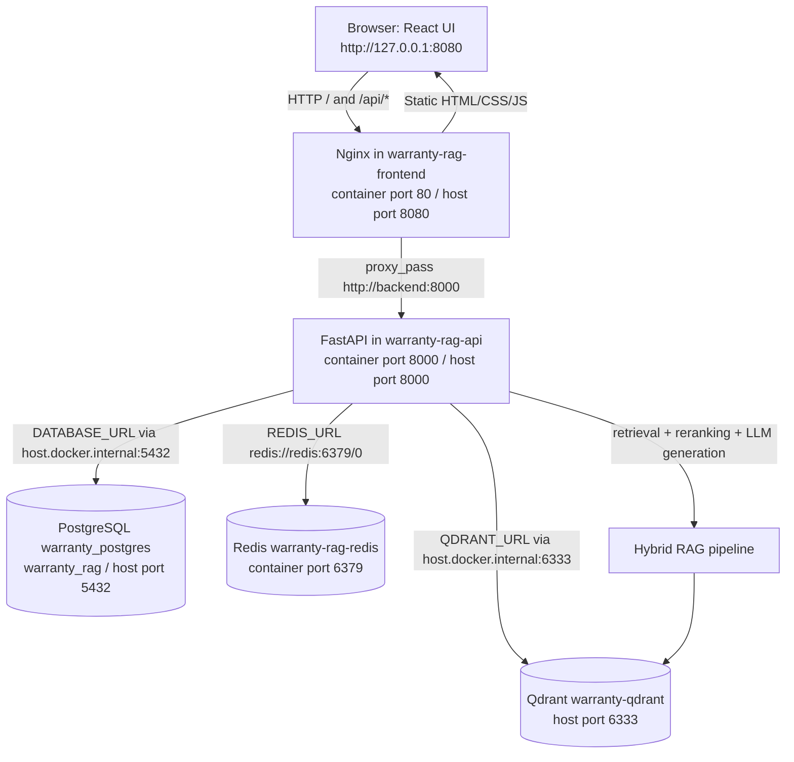
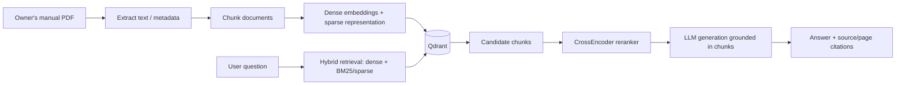

# S-Presso Enterprise RAG — Docker Architecture, Build Challenges & Troubleshooting

> **Project:** `D:\warranty_RAG`  
> **Document scope:** Dockerized React + FastAPI enterprise Retrieval-Augmented Generation (RAG) application  
> **Last verified from troubleshooting session:** 3–4 November 2026  
> **Evidence note:** Commands, ports, container names, error messages and fixes below are based on the shared terminal output and project history. API routes not explicitly confirmed by source code are marked **verify in OpenAPI**.

## 1. Executive summary

The application provides a browser-based conversational interface to the Maruti Suzuki S-Presso owner's manual. A React/Vite frontend is served by Nginx; FastAPI handles authentication, chat, retrieval, and persistence. PostgreSQL stores users and conversations; Redis supports request controls; Qdrant stores indexed document embeddings and retrieval payloads. The retrieval pipeline has used hybrid sparse/dense search, CrossEncoder reranking, and cited responses.

The deployment ultimately reached a working **Nginx → FastAPI** HTTP path and the user confirmed the login/origin fix worked. Full end-to-end citation quality and chat persistence should still be tested separately.

## 2. Architecture



**Key network distinction:** The frontend container uses the **Compose service name** `backend` to contact FastAPI (`http://backend:8000`). FastAPI uses the Docker Desktop host gateway `host.docker.internal` to reach separately published PostgreSQL and Qdrant ports, while it uses the Compose service name `redis` for Redis.

### 2.1 Browser request lifecycle

1. User opens `http://127.0.0.1:8080`.
2. Docker forwards host port **8080** to Nginx container port **80**.
3. Nginx serves the React production build from `/usr/share/nginx/html`.
4. Browser sends `/api/v1/...` requests to the same origin (`:8080`), **provided the frontend is configured to use relative API URLs**.
5. Nginx matches `location /api/` and proxies to `http://backend:8000`.
6. FastAPI validates the request origin on state-changing methods, processes authentication/chat, and accesses PostgreSQL, Redis, and Qdrant as needed.
7. Nginx returns the API response to the browser.

> **Verification caveat:** The actual production Vite API base URL was not pasted into the session. Inspect `frontend/src/api.ts` and browser DevTools to confirm that login/chat requests go through `:8080`, not directly to `:8000`.

## 3. Container inventory and port map

### 3.1 Project-specific containers: five

| Container | Compose service / ownership | Image | Container port | Published host port | Function |
|---|---|---|---|---|---|
| `warranty-rag-frontend` | `frontend` | `warranty_rag-frontend` | 80 | **8080** | Nginx serves React and proxies `/api/` |
| `warranty-rag-api` | `backend` | `warranty_rag-backend` | 8000 | **8000** | FastAPI auth, chat, RAG, persistence |
| `warranty-rag-redis` | `redis` | `redis:7-alpine` | 6379 | Not published in observed Compose status | Redis caching/rate limiting/request controls |
| `warranty_postgres` | Existing/orphan `postgres` container | `postgres:16` | 5432 | **5432** | `warranty_rag` relational database |
| `warranty-qdrant` | Separate container, outside current Compose service listing | `qdrant/qdrant` | 6333, 6334 | **6333–6334** | Vector search and document payloads |

**Additional, separate project container:** `agentic_postgres` (`postgres:16`, `agentic_analytics`, `agent_user`) was also present. It is **not part of the five-container warranty RAG runtime**. It was previously published on host port **5433**, and later observed stopped. Confusing it with `warranty_postgres` caused failed database-login tests.

**Why the Compose warning appears:** `warranty_postgres` is shown as an **orphan container** because the active Compose configuration no longer manages a matching `postgres` service. Do **not** run `--remove-orphans` without first planning how to preserve/manage this database. Do not use `docker compose down -v` or delete volumes during troubleshooting.

### 3.2 Port and hostname rules

| Caller | Destination | Correct address |
|---|---|---|
| Browser | React + proxied API | `http://127.0.0.1:8080` |
| Windows CMD | FastAPI direct | `http://127.0.0.1:8000` |
| Nginx container | FastAPI container | `http://backend:8000` |
| FastAPI container | PostgreSQL published on Windows | `host.docker.internal:5432` |
| Windows local Python | PostgreSQL | `localhost:5432` |
| FastAPI container | Redis in Compose network | `redis:6379` |
| FastAPI container | Qdrant published on Windows | `host.docker.internal:6333` |
| Windows CMD | Qdrant REST API | `http://localhost:6333` |

**Important:** `localhost` inside a container means *that same container*. It does not refer to another container or automatically to the Windows host.

## 4. Configuration: known-good patterns

### 4.1 Backend environment in `docker-compose.yml`

The user shared this configuration:

```yaml
services:
  backend:
    environment:
      QDRANT_URL: http://host.docker.internal:6333
      REDIS_URL: redis://redis:6379/0
      DATABASE_URL: ${DOCKER_DATABASE_URL:?Set DOCKER_DATABASE_URL in .env}
```

This is a **configuration excerpt**, not a complete Compose file. Keep other service definitions, mounts, ports and dependencies from the actual project file.

### 4.2 `.env` examples

```dotenv
# Local Python process running directly on Windows
DATABASE_URL=postgresql+psycopg://warranty_user:<EXISTING_PASSWORD>@localhost:5432/warranty_rag

# FastAPI container accessing the published host port
DOCKER_DATABASE_URL=postgresql+psycopg://warranty_user:<EXISTING_PASSWORD>@host.docker.internal:5432/warranty_rag
```

Replace the placeholder with the **existing** database password. Never commit real passwords to Git. URL-encode special password characters when embedding them in a URI. The Compose expression maps `DOCKER_DATABASE_URL` into the container's environment variable named `DATABASE_URL`.

### 4.3 Nginx config (confirmed by `nginx -T`)

```nginx
server {
    listen 80;
    server_name _;

    root /usr/share/nginx/html;
    index index.html;

    location /api/ {
        proxy_pass http://backend:8000;
        proxy_http_version 1.1;

        proxy_set_header Host $host;
        proxy_set_header X-Real-IP $remote_addr;
        proxy_set_header X-Forwarded-For $proxy_add_x_forwarded_for;
        proxy_set_header X-Forwarded-Proto $scheme;
    }

    location / {
        try_files $uri $uri/ /index.html;
    }
}
```

The absence of a trailing slash on `proxy_pass http://backend:8000;` preserves the `/api/...` path when forwarding it.

### 4.4 Origin security middleware (`api/origin.py`)

The initial `ALLOWED_ORIGINS` included only `localhost` and `127.0.0.1` on ports **5173** and **8000**. The Docker UI uses **8080**, causing a `403` on login/register POST requests. The fix was to add both of these exact origins:

```python
ALLOWED_ORIGINS = {
    "http://localhost:5173",
    "http://127.0.0.1:5173",
    "http://localhost:8000",
    "http://127.0.0.1:8000",
    "http://localhost:8080",
    "http://127.0.0.1:8080",
}
```

The middleware checks `Origin` for `POST`, `PUT`, `PATCH` and `DELETE`; it returns `403 {"detail":"Untrusted request origin"}` if not approved. **Keep origin validation and CSRF protections enabled**. Separately verify `CORSMiddleware` in `api/main.py` if the browser reports CORS failures.

## 5. Data architecture

### 5.1 PostgreSQL

**Verified database:** `warranty_rag`, owned/accessed by `warranty_user`, in container `warranty_postgres`. The following **six tables** were verified using `\dt`:

| Table | Role |
|---|---|
| `users` | Registered accounts; `id`, `email`, `password_hash`, `created_at` were observed |
| `auth_sessions` | Authentication session persistence |
| `conversations` | Conversation records associated with users |
| `messages` | Stored chat messages |
| `chat_request_records` | Chat request tracking; inspect schema for precise semantics |
| `alembic_version` | Database migration version |

The `users` table has a unique email index and foreign-key relationships from sessions, conversations and request records. **Passwords are hashed, not recoverable as plaintext**; a forgotten password should be reset with the application's existing hashing implementation, preserving the original user ID and chats.

### 5.2 Qdrant

**Verified collections** returned by `GET /collections`:

- `spresso_embedding_demo`
- `spresso_hybrid_v1`
- `spresso_manual_full`
- `spresso_manual_sample`

The `spresso_manual_full` collection was previously indexed with **2,412 chunks** from the S-Presso owner's manual. This count is from the earlier ingestion workflow, not a freshly measured collection point count. Query `GET /collections/spresso_manual_full` to inspect its current state.

The existing Docker volume `warranty_qdrant_storage` was verified to exist. **Volume existence alone does not prove the running container is mounted to it**; use `docker inspect warranty-qdrant --format "{{json .Mounts}}"` to confirm the actual mount before any recreation.

### 5.3 RAG retrieval pipeline (project design)



Prior work used LangChain/LCEL, FastEmbed sparse retrieval, hybrid search and CrossEncoder reranking. Confirm the exact currently deployed embedding model, LLM provider, collection name and reranker settings from application configuration before documenting them as runtime facts.

## 6. Docker build and runtime challenges — incident log

| # | Symptom / evidence | Root cause or likely cause | Resolution / verification |
|---|---|---|---|
| 1 | Backend restarted with `ModuleNotFoundError: pwdlib` | Required auth dependency missing from image | Added `pwdlib[argon2]` to `requirements.txt`, rebuilt backend |
| 2 | `email-validator` missing | Pydantic email validation extra not installed | Added `pydantic[email]` |
| 3 | `ModuleNotFoundError: fastembed` | Sparse retrieval dependency absent from image | Added `fastembed`; verified `from fastembed import SparseTextEmbedding` inside a fresh image |
| 4 | Same missing-package error after successful build | Old backend container still running an older image | `docker compose up -d --no-deps --force-recreate backend` |
| 5 | Very long backend build (one observed build ~1,496 s); earlier Docker Desktop export/Compose instability | Large Python/ML dependency image and/or Docker Desktop instability | Avoid unnecessary full rebuilds; inspect image/container state and rebuild only changed service |
| 6 | `curl http://localhost:8080/api/v1/health` → `curl: (52) Empty reply from server` | Windows-to-Docker published-port/container state issue; precise underlying cause not proven | Internal Nginx and backend tests both returned 200; recreating **frontend** restored HTTP 200 |
| 7 | `502 Bad Gateway` after backend recreation | Nginx upstream likely held old backend container IP after recreation | Confirmed backend direct HTTP 200 and container-to-container HTTP 200; recreating **frontend** restored 200 |
| 8 | `FATAL: role "warranty_user" does not exist` when querying `agentic_postgres` | Wrong PostgreSQL container: `agentic_postgres` has `agent_user`/`agentic_analytics` | Inspected `POSTGRES_USER` and `POSTGRES_DB`; used `warranty_postgres` with `warranty_user`/`warranty_rag` |
| 9 | `FATAL: role "postgres" does not exist` on `agentic_postgres` | That instance was initialized with a non-default superuser (`agent_user`) | Inspect container environment instead of assuming `postgres` role exists |
| 10 | Qdrant `curl: (7) Failed to connect ... :6333` | `warranty-qdrant` container was stopped (`Exited (255)`) | Started existing container; `/collections` returned four collections |
| 11 | `403 {"detail":"Untrusted request origin"}` on login/new account | `api/origin.py` omitted `http://localhost:8080` and `http://127.0.0.1:8080` | Added port-8080 origins, rebuilt/recreated backend and refreshed frontend; user confirmed it works |
| 12 | `Found orphan containers (warranty_postgres)` | Existing database container not managed by active Compose file | Kept it running and preserved data; did not use `--remove-orphans` |
| 13 | Windows CMD reports `'INFO:' is not recognized` or `'email' is not recognized` | Copied log/SQL output was pasted as a command | Run only command lines; do not paste expected output back into CMD |

### 6.1 Important lesson: build vs recreate vs restart

- **`docker compose build backend`**: constructs a new image with changed source/dependencies; does **not** necessarily replace the existing running container.
- **`docker compose up -d --no-deps --force-recreate backend`**: replaces the backend container using the available image and updated environment; does not build the image.
- **`docker compose up -d --no-deps --force-recreate frontend`**: replaces Nginx frontend container; can refresh its resolved upstream address and published-port state.
- **`docker start warranty_postgres` / `docker start warranty-qdrant`**: starts an existing stopped container while preserving its existing mounts and data.

## 7. API inventory

### 7.1 Confirmed endpoint

| Method | Path | Purpose | Evidence |
|---|---|---|---|
| `GET` | `/api/v1/health` | Application health | Verified HTTP 200 directly on port 8000 and via Nginx on port 8080; response `{"status":"ok","service":"spresso-rag-api"}` |

### 7.2 API families known from project development — verify exact methods/paths

The following **families** were previously implemented or discussed in the RAG backend, but the precise live route table was not included in the supplied logs. Avoid treating these as a verified OpenAPI specification until checked:

| Route family | Expected functionality | Status |
|---|---|---|
| `/api/v1/auth` | Registration, login, logout; cookie-based authentication | Known project feature; exact routes/methods need verification |
| `/api/v1/chat` | Submit a chat question and retrieve a RAG answer | Known project feature; exact request/response schema needs verification |
| `/api/v1/conversations` | List conversations and retrieve message history | Known project feature; exact routes/methods need verification |
| `/api/v1/health` | Health endpoint | **Verified** |
| `/docs` | FastAPI Swagger UI | Expected from FastAPI defaults; verify whether enabled in deployed app |
| `/openapi.json` | Machine-readable OpenAPI schema | Expected from FastAPI defaults; verify whether enabled |

**Get the authoritative live endpoint list:**

```cmd
curl -i http://127.0.0.1:8080/openapi.json
```

If the endpoint is enabled, visit `http://127.0.0.1:8000/docs` or use this Windows CMD command to print the actual route list:

```cmd
docker exec warranty-rag-api python -c "from api.main import app; print('\n'.join(sorted(str(sorted(r.methods)) + ' ' + r.path for r in app.routes if hasattr(r, 'methods'))))"
```

This introspects the actual deployed FastAPI application and is preferable to guessing route names.

### 7.3 External APIs used by the system

| Service | Endpoint / example | Function |
|---|---|---|
| Qdrant REST | `GET http://localhost:6333/collections` | List vector collections |
| Qdrant REST | `GET http://localhost:6333/collections/spresso_manual_full` | Inspect collection status |
| PostgreSQL | SQL over port 5432 | Users, sessions, conversations, messages |
| Redis | Redis protocol on port 6379 | Backend request coordination/rate limiting |

## 8. Repeatable troubleshooting checklist (Windows CMD)

### 8.1 Inspect runtime

```cmd
cd /d D:\warranty_RAG
docker compose ps -a
docker ps -a --filter "name=qdrant"
docker ps -a --filter "name=postgres"
```

### 8.2 Check FastAPI and Nginx

```cmd
curl -i http://127.0.0.1:8000/api/v1/health
curl -i http://127.0.0.1:8080/api/v1/health
docker logs warranty-rag-api --tail 60
docker logs warranty-rag-frontend --tail 60
```

### 8.3 Isolate proxy/network issues

```cmd
docker exec warranty-rag-frontend nginx -t
docker exec warranty-rag-frontend nginx -T
docker exec warranty-rag-frontend wget -S -O - http://backend:8000/api/v1/health
docker exec warranty-rag-frontend wget -S -O - http://127.0.0.1:80/api/v1/health
docker port warranty-rag-frontend
curl -4 -v http://127.0.0.1:8080/api/v1/health
```

**Interpretation:**

- Direct backend fails: investigate backend logs, startup and dependency errors.
- Direct backend works, Nginx-to-backend fails: investigate Compose network and service name.
- Nginx-to-backend works, internal Nginx fails: inspect `nginx -T`, upstream resolution and Nginx logs.
- Internal Nginx works, Windows `:8080` fails: investigate published port, Docker Desktop forwarding, frontend container state.
- Backend recreated, then Nginx returns 502: recreate the frontend and retest; consider dynamic DNS resolution for a more resilient production Nginx setup.

### 8.4 Verify PostgreSQL without exposing secrets

```cmd
docker start warranty_postgres
docker exec warranty_postgres pg_isready -U warranty_user -d warranty_rag
docker exec warranty_postgres psql -U warranty_user -d warranty_rag -c "\dt"
docker exec warranty_postgres psql -U warranty_user -d warranty_rag -c "SELECT COUNT(*) FROM messages;"
docker port warranty_postgres
```

Do not query the `password_hash` column unless necessary for an authorized password-reset operation. Do not share `.env` secrets or connection URLs containing passwords.

### 8.5 Verify Qdrant and Redis

```cmd
docker start warranty-qdrant
curl http://127.0.0.1:6333/collections
curl http://127.0.0.1:6333/collections/spresso_manual_full
docker exec warranty-rag-redis redis-cli ping
```

Expected Redis response: `PONG`.

### 8.6 Recover from a 403 on login

1. Open browser DevTools → Network; inspect the failing login request's **Request URL** and **Origin** header.
2. Inspect `api/origin.py`; add the actual trusted frontend origin, including the exact scheme/hostname/port.
3. Check `api/main.py` CORS configuration if a browser CORS error persists.
4. Rebuild the backend **only if Python source changed and is baked into the image**.
5. Recreate backend, then frontend if Nginx returns 502.
6. Do **not** disable origin/CSRF validation as a workaround.

## 9. Safe deployment and data-preservation practices

- Preserve the existing PostgreSQL and Qdrant containers/volumes. Do not run `docker compose down -v`, `docker volume prune`, or `--remove-orphans` during routine troubleshooting.
- Verify backups before changing container ownership or moving databases into Compose.
- Use `.env` for local secrets; use a managed secret store for production.
- Use non-default, least-privilege credentials and keep database/vector ports private in production.
- Prefer same-origin `/api/...` frontend requests via Nginx, with secure session cookies, CSRF protections, authorization checks and rate limiting.
- Add container health checks, restart policies, structured logs, request IDs, latency metrics and alerting before cloud deployment.
- Pin image/dependency versions and scan images; avoid unnecessary full rebuilds of large ML images.
- Consider Nginx runtime DNS resolution or a controlled reload strategy to avoid stale upstream IPs when backend containers are replaced.

## 10. Final validation checklist

- [x] FastAPI `/api/v1/health` returned HTTP 200 on host port 8000.
- [x] Nginx `/api/v1/health` returned HTTP 200 on host port 8080 after frontend recreation.
- [x] Nginx served the React HTML document internally with HTTP 200.
- [x] Redis container reported healthy in Compose status.
- [x] PostgreSQL `warranty_rag` and its six tables were verified.
- [x] Qdrant returned four existing collections.
- [x] Port-8080 origin validation was corrected; user reported login/app working.
- [ ] Confirm frontend production API base URL is same-origin.
- [ ] Verify login/logout, cookie/CSRF behavior and registration in browser DevTools.
- [ ] Run a manual S-Presso warranty question and validate page citations against the manual.
- [ ] Confirm chat message counts increase in PostgreSQL and history survives reload.
- [ ] Verify exact live FastAPI endpoints and schemas using `/openapi.json`.
- [ ] Confirm current Qdrant point counts and container volume mounts.
- [ ] Add automated smoke tests, backups, health checks and monitoring.

## 11. Useful project commands — quick reference

```cmd
:: Status
docker compose ps -a

:: Recreate backend after .env changes (no rebuild)
docker compose up -d --no-deps --force-recreate backend

:: Rebuild backend after source/dependency changes
docker compose build backend
docker compose up -d --no-deps --force-recreate backend

:: Refresh Nginx upstream after backend replacement
docker compose up -d --no-deps --force-recreate frontend

:: API smoke test
curl -i http://127.0.0.1:8080/api/v1/health

:: Database tables
docker exec warranty_postgres psql -U warranty_user -d warranty_rag -c "\dt"

:: Vector collections
curl http://127.0.0.1:6333/collections

:: FastAPI route inventory
docker exec warranty-rag-api python -c "from api.main import app; print('\n'.join(sorted(str(sorted(r.methods)) + ' ' + r.path for r in app.routes if hasattr(r, 'methods'))))"
```

---

**Documentation status:** Architecture, container names, ports, incidents and fixes are grounded in the troubleshooting history. Exact endpoint definitions, request schemas, the deployed frontend API base URL, and the precise current RAG model configuration require direct inspection of the running source/OpenAPI output.
