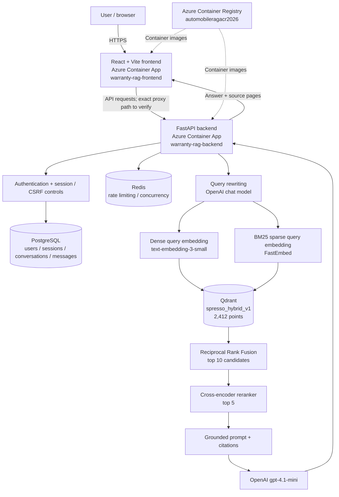
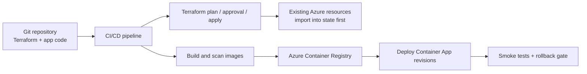
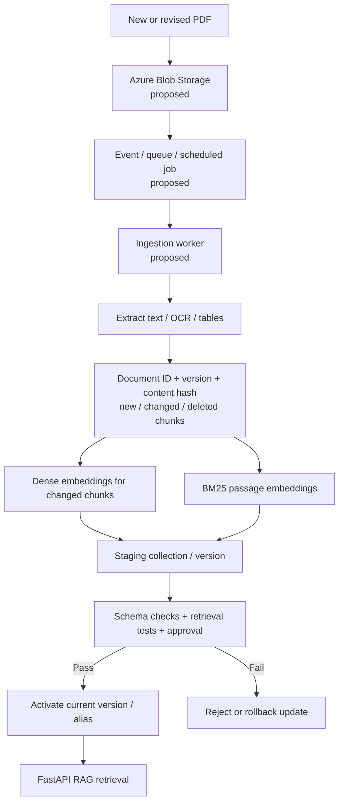

# S-Presso Enterprise RAG — Architecture and Evolution Plan

**Documentation date:** 12 November 2026  
**Status:** Current working architecture plus explicitly labeled proposed enhancements

## 1. Architecture at a glance



**Network caveat:** The backend was observed with an internal Container Apps hostname. The exact routing/proxy mechanism used by the public frontend to reach the backend is not established in the captured evidence. Verify the deployed ingress, reverse proxy, and CORS settings before drawing a definitive network diagram.

## 2. Current deployed components

| Layer | Technology | Responsibility | Evidence/status |
|---|---|---|---|
| UI | React + Vite | Login, chat UI, source citations | Hosted app confirmed working |
| API | Python FastAPI | Auth, conversations, chat endpoint, orchestration | Hosted chat confirmed working |
| Runtime | Azure Container Apps | Run frontend/backend images | Named apps and backend revision observed |
| Registry | Azure Container Registry | Store versioned images | `automobileragacr2026` observed |
| Relational data | PostgreSQL | Users, sessions, conversations, messages, idempotency | Alembic migration succeeded |
| Cache/coordination | Redis | Rate limits, concurrency and related controls | App integration exists; scale behavior untested |
| Vector database | Qdrant | Dense and sparse retrieval | `spresso_hybrid_v1`, 2,412 points |
| Dense embeddings | OpenAI `text-embedding-3-small` | 1536-dimensional semantic vectors | Inspected code and collection schema |
| Sparse embeddings | FastEmbed `Qdrant/bm25` | Term-sensitive sparse vectors | Inspected code and migrated points |
| Fusion | Qdrant RRF | Merge dense and sparse results | Inspected code and retrieval test |
| Reranking | Cross-encoder | Reorder retrieved candidates | Complete pipeline test succeeded |
| LLM | OpenAI `gpt-4.1-mini` | Answer generation | Inspected `services/lcel_rag.py` |

The deployment details of PostgreSQL, Redis and Qdrant hosting/network placement are not sufficiently documented to classify them as specific Azure managed services.

## 3. Runtime request sequence

```mermaid
sequenceDiagram
    actor User
    participant UI as React frontend
    participant API as FastAPI
    participant DB as PostgreSQL
    participant LLM as OpenAI
    participant Q as Qdrant
    participant CE as Cross-encoder
    User->>UI: Ask warranty question
    UI->>API: Authenticated chat request
    API->>DB: Load user conversation/history
    API->>LLM: Rewrite query (if configured)
    LLM-->>API: Search-oriented question
    API->>LLM: Generate dense query embedding
    LLM-->>API: 1536-dim vector
    Note over API: Generate BM25 sparse query locally
    API->>Q: Dense + BM25 prefetch; RRF fusion
    Q-->>API: Top 10 chunks and metadata
    API->>CE: Rerank candidate chunks
    CE-->>API: Top 5 chunks
    API->>LLM: Grounded prompt with source context
    LLM-->>API: Answer citing [Source N]
    API->>DB: Persist conversation/message
    API-->>UI: Answer and source metadata
    UI-->>User: Render response and citations
```

The diagram is a logical flow. Exact DB transaction ordering and chat streaming behavior should be verified in code before using this as a strict sequence specification.

## 4. Qdrant data design

### Original collection — `spresso_manual_full`

- 2,412 points.
- One unnamed dense vector of dimension 1536, cosine distance.
- No sparse vector configuration.
- Payload keys observed: `chunk_id`, `source_file`, `document_title`, `page_number`, `text`, `embedding_model`.

### Current hybrid collection — `spresso_hybrid_v1`

- 2,412 migrated points.
- Named `dense`: 1536-dimensional cosine vector.
- Named `bm25`: sparse vector with IDF modifier.
- Dense vectors reused from original collection; BM25 passage embeddings generated from existing text.
- Original point IDs and payload preserved.

### Retrieval implementation (verified code)

```python
# Conceptual excerpt based on inspected implementation
result = qdrant.query_points(
    collection_name="spresso_hybrid_v1",
    prefetch=[
        models.Prefetch(query=dense_vector, using="dense", limit=30),
        models.Prefetch(query=sparse_vector, using="bm25", limit=30),
    ],
    query=models.FusionQuery(fusion=models.Fusion.RRF),
    limit=10,
    with_payload=True,
)
# Cross-encoder reranks the candidates to top 5.
```

**Observed validation:** Warranty question retrieved manual page 8 at rank 1, RRF score 0.7. The final answer correctly reported 36 months / 100,000 km and source citations.

## 5. Security and reliability boundaries

### Implemented or observed

- User authentication, session persistence, CSRF-related backend design, per-user conversation persistence.
- Azure Container App secret reference for `OPENAI_API_KEY`.
- Backend internal Container Apps hostname observed.
- Redis-based rate limiting / concurrency logic in project design.
- Grounding instructions: answer from manual context; cite `[Source N]`; treat retrieved text as data, not instructions.

### Proposed hardening — not yet validated as deployed

- Managed identities for Azure resource access; Key Vault and secret rotation.
- Explicit frontend-to-backend ingress/proxy security review and private networking where appropriate.
- Document-level RBAC/ABAC and retrieval filtering for multi-tenant or sensitive content.
- Centralized logging and tracing; redaction of PII, tokens and session data.
- WAF where appropriate, dependency/container scanning, non-root containers, TLS enforcement.
- Retry/backoff, circuit breakers, timeouts, idempotency tests, readiness/liveness probes, rollback.
- Load tests and autoscaling rules; backup/restore and disaster recovery tests.

## 6. Proposed infrastructure automation with Terraform



### Suggested Terraform repository layout

```text
infra/
  terraform/
    versions.tf
    providers.tf
    backend.tf
    variables.tf
    main.tf
    outputs.tf
    environments/
      dev.tfvars
modules/
  container-apps/
  container-registry/
  monitoring/
.github/workflows/
  backend-ci-cd.yml
  frontend-ci-cd.yml
  terraform-plan.yml
```

**Migration strategy for existing infrastructure:**

1. Inventory actual Azure resource IDs and settings.
2. Configure a secure, remote Terraform state backend and state locking.
3. Define resources to match reality; import each existing resource into Terraform state.
4. Run `terraform plan` and resolve drift until no unintended create/replace/destroy actions remain.
5. Add changes incrementally (autoscaling, monitoring, identity, policy) behind plan approval.
6. Never commit `.tfstate`, `.tfvars` with secrets, or credentials.

**Important:** Terraform is **planned**, not currently established as managing this deployment.

## 7. Proposed document update / reindex architecture



### Recommended update algorithm

1. **Receive:** Ingest a new S-Presso manual or revised warranty-policy document from an approved source.
2. **Identify:** Assign stable `document_id`, version, effective date, and source reference.
3. **Extract:** Parse text, tables, and scanned pages using OCR where needed; retain page metadata.
4. **Compare:** Compute document and chunk hashes to detect new/changed/removed content.
5. **Embed:** Reuse unchanged vectors where possible; generate OpenAI dense vectors and FastEmbed BM25 sparse vectors only for new/changed chunks.
6. **Upsert:** Use deterministic point IDs and named `dense`/`bm25` vectors; preserve source metadata.
7. **Handle deletion:** Deactivate or remove superseded chunks only after validating the replacement; keep rollback snapshots or a staging collection.
8. **Validate:** Check point counts, vector schema, retrieval tests, citations, conflicting policy terms, and answer correctness.
9. **Publish:** Activate the approved version (e.g., Qdrant alias switch or `is_active` filtering with suitable indexes).
10. **Observe:** Log ingestion outcome, latency, errors, version transitions, and evaluation scores.

### Proposed payload extension

```json
{
  "document_id": "spresso-owner-manual",
  "document_version": "2026-11",
  "effective_date": "2026-11-01",
  "is_active": true,
  "content_hash": "<sha256-of-normalized-chunk>",
  "source_file": "spresso_manual.pdf",
  "page_number": 8,
  "chunk_id": "page_8_chunk_0",
  "text": "<extracted-document-text>"
}
```

The JSON is an **illustrative future schema**, not a claim that these fields already exist in the deployed collection. Use actual publication/effective dates from the source; the sample values above are placeholders.

### Critical update scenario — conflicting warranty rules

If a new warranty policy changes a warranty term, uploading both old and new text without version filtering can cause contradictory answers. Prefer approved-version retrieval, effective-date checks, a regression test for the warranty question, and rollback capability. New requirements may also be structured business rules rather than PDF text; such rules may belong in an authoritative rules engine or database, with RAG providing explanatory citations.

## 8. Monitoring and evaluation (proposed)

| Layer | Key measurements |
|---|---|
| Frontend/API | Availability, HTTP 5xx, p50/p95 latency, request volume |
| Auth/database | Login failures, migration state, DB pool saturation |
| Redis | Connectivity, throttling counts, cache hit rate where used |
| Retrieval | Qdrant query latency, empty results, recall@k, MRR, top-k quality |
| Reranker | Latency, relevance lift over first-stage retrieval |
| LLM | Token use, cost, 401/429/5xx errors, timeouts, groundedness |
| Ingestion | Documents processed, changed chunks, failures, validation results |
| Infrastructure | CPU/memory, replicas, restart counts, spend/budget alerts |

## 9. Target CI/CD flow (proposed)

```text
Commit / Pull Request
  -> lint + unit tests + security scans
  -> build frontend/backend Docker images
  -> push immutable tags to ACR
  -> Terraform plan (if infra changed) + approval
  -> database migrations / compatibility checks
  -> deploy new Container Apps revisions
  -> health + authentication + Qdrant + chat smoke tests
  -> traffic promotion or rollback
```

**Document ingestion is separate from app release:** A new PDF should trigger an ingestion workflow, not necessarily a Docker rebuild. Only code/schema changes require a new application release.

## 10. Decisions to verify before production sign-off

- Exact current hosting, network endpoints, and backup strategy for PostgreSQL, Redis and Qdrant.
- Actual frontend-to-internal-backend proxy path, ingress and CORS behavior.
- Whether chat streaming/SSE is enabled or whether requests are standard HTTP responses.
- Current autoscaling, minimum replicas, resource limits and monthly cost.
- Monitoring/alert configuration and data retention.
- Whether all document pages and OCR/table extraction quality meet requirements.
- Model version pinning, prompt versioning, evaluation baseline, and access-control requirements.

## 11. Summary

**Current state:** A functioning Azure-hosted S-Presso RAG application with authentication, persistent chat, OpenAI embeddings and LLM generation, Qdrant hybrid retrieval (2,412 points), cross-encoder reranking, and citations.

**Next architecture milestone:** Import Azure infrastructure into Terraform safely, implement automated CI/CD and observability, then add versioned document ingestion with validation and rollback.
