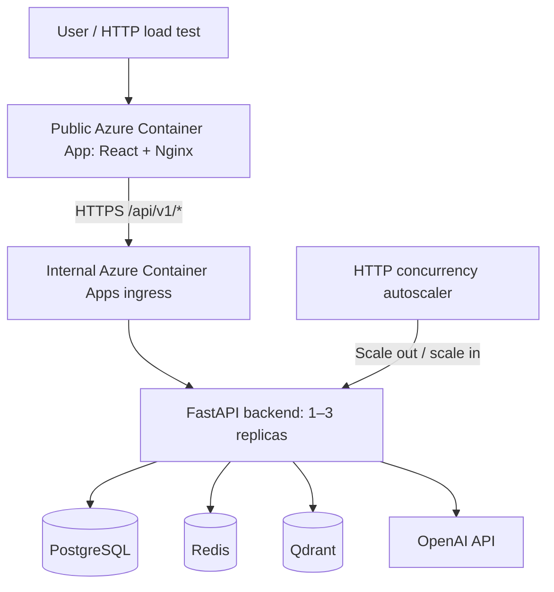

# S-Presso Azure RAG — Autoscaling Implementation and Validation

**Project:** S-Presso owner's-manual RAG application  
**Platform:** Microsoft Azure Container Apps  
**Resource group:** `rg-automobile-rag-dev`  
**Backend app:** `warranty-rag-backend`  
**Frontend app:** `warranty-rag-frontend`  
**Validated backend revision:** `warranty-rag-backend--0000008`  
**Document status:** Based on commands and results observed during our deployment session (November 2026).

## 1. Objective

Enable HTTP-based autoscaling for the FastAPI RAG backend, verify the frontend-to-backend route, and confirm that Azure creates additional backend replicas under sustained HTTP traffic. The load test uses a lightweight health endpoint, **not** actual RAG chat inference.

## 2. Architecture



The backend uses internal ingress. The frontend's Nginx reverse proxy forwards `/api/` requests to the backend internal hostname. The exact hosting arrangement of PostgreSQL, Redis, and Qdrant was not verified during this autoscaling exercise.

## 3. Initial configuration — before changes

We inspected scaling with:

```cmd
az containerapp show --name warranty-rag-backend --resource-group rg-automobile-rag-dev --query "properties.template.scale" --output json
```

Observed:

```json
{
  "cooldownPeriod": 300,
  "maxReplicas": 1,
  "minReplicas": 1,
  "pollingInterval": 30,
  "rules": null
}
```

**Interpretation:** The backend was limited to a single replica; no explicit HTTP scaling rule was configured.

## 4. Configure HTTP-based autoscaling

We used the following Azure CLI update command:

```cmd
az containerapp update --name warranty-rag-backend --resource-group rg-automobile-rag-dev --min-replicas 1 --max-replicas 3 --scale-rule-name http-scaling --scale-rule-type http --scale-rule-http-concurrency 10
```

Then checked the result:

```cmd
az containerapp show --name warranty-rag-backend --resource-group rg-automobile-rag-dev --query "properties.template.scale" --output json
```

**Verified configuration:**

```json
{
  "cooldownPeriod": 300,
  "maxReplicas": 3,
  "minReplicas": 1,
  "pollingInterval": 30,
  "rules": [
    {
      "http": {
        "auth": [],
        "metadata": { "concurrentRequests": "10" }
      },
      "name": "http-scaling"
    }
  ]
}
```

- `minReplicas=1`: keep at least one backend replica.
- `maxReplicas=3`: permit up to three backend replicas.
- `concurrentRequests=10`: HTTP scaler target, **not** a limit of 10 users.
- `pollingInterval=30`: scaling evaluation interval, in seconds.
- `cooldownPeriod=300`: scale-down cooldown, in seconds; not a guarantee that replicas drop exactly at five minutes.

The update resulted in the active revision `warranty-rag-backend--0000008`.

## 5. Diagnose and resolve the health-check path / 504 issue

### 5.1 Symptoms

A request to the public frontend initially returned:

```cmd
curl -i https://warranty-rag-frontend.bravecoast-33edf5ab.centralindia.azurecontainerapps.io/api/v1/health
```

Observed response: `HTTP/1.1 504 Gateway Timeout` from Nginx.

Inside the backend, testing `http://127.0.0.1:8000/health` returned `404 Not Found`. That was a **wrong URL path**, not proof of a failed FastAPI server.

### 5.2 Inspect the backend

Connect to the backend:

```cmd
az containerapp exec --name warranty-rag-backend --resource-group rg-automobile-rag-dev --command "/bin/sh"
```

We inspected `/app/api/routes/health.py` and `/app/api/main.py`. The router declares `/health`, and `api.main` mounts it under `/api/v1`. The correct path is **`/api/v1/health`**. The Dockerfile runs `uvicorn api.main:app --host 0.0.0.0 --port 8000`.

Test from inside the backend container (`#` prompt):

```sh
python -c "import urllib.request; r=urllib.request.urlopen('http://127.0.0.1:8000/api/v1/health',timeout=10); print(r.status, r.read().decode())"
```

**Observed:**

```text
200 {"status":"ok","service":"spresso-rag-api"}
```

### 5.3 Inspect Nginx proxy

Exit the backend shell, then enter the frontend:

```cmd
az containerapp exec --name warranty-rag-frontend --resource-group rg-automobile-rag-dev --command "/bin/sh"
```

Inspect proxy configuration:

```sh
nginx -T 2>&1 | grep -A 20 'location /api/'
```

Observed relevant configuration:

```nginx
location /api/ {
    proxy_pass https://warranty-rag-backend.internal.bravecoast-33edf5ab.centralindia.azurecontainerapps.io;
    proxy_http_version 1.1;
    proxy_ssl_server_name on;
    proxy_set_header Host warranty-rag-backend.internal.bravecoast-33edf5ab.centralindia.azurecontainerapps.io;
    proxy_set_header X-Real-IP $remote_addr;
    proxy_set_header X-Forwarded-For $proxy_add_x_forwarded_for;
    proxy_set_header X-Forwarded-Proto $scheme;
}
```

Test backend access from the frontend container:

```sh
wget -S -O - -T 10 https://warranty-rag-backend.internal.bravecoast-33edf5ab.centralindia.azurecontainerapps.io/api/v1/health
```

**Observed:** `HTTP/1.1 200 OK`, showing that frontend-to-backend HTTPS connectivity worked.

Finally, retesting the public frontend URL returned the expected `200 OK` response. **The earlier 504 was no longer reproducible; its root cause was not definitively identified.** No Nginx configuration change was needed in this session.

## 6. First baseline load test

Script: `test_autoscaling.py` (already present in the project). It sent 100 health-check requests with a configured concurrency of 10.

```cmd
python test_autoscaling.py
```

**Observed:**

```text
Total requests: 100
Successful requests: 100
Failed requests: 0
Duration: 0.73 seconds
```

This was a successful smoke/load test but too short to establish autoscaling behavior.

## 7. Verify active revision and baseline replica

```cmd
az containerapp revision list --name warranty-rag-backend --resource-group rg-automobile-rag-dev --query "[].{Name:name,Active:properties.active,Traffic:properties.trafficWeight}" --output table
```

**Observed:** `warranty-rag-backend--0000008`, `Active=True`, `Traffic=100`.

```cmd
az containerapp replica list --name warranty-rag-backend --resource-group rg-automobile-rag-dev --revision warranty-rag-backend--0000008 --query "[].{Name:name,State:properties.runningState}" --output table
```

**Observed before sustained test:** one `Running` replica, `warranty-rag-backend--0000008-59d4d565cd-zhcfp`.

## 8. Sustained 90-second load test

We created `test_autoscaling_sustained.py` to send requests continuously through the **public frontend** to `/api/v1/health`, with 20 asynchronous workers for 90 seconds.

Reference script:

```python
import asyncio
import time
from collections import Counter
import httpx

URL = (
    "https://warranty-rag-frontend."
    "bravecoast-33edf5ab.centralindia.azurecontainerapps.io"
    "/api/v1/health"
)
DURATION_SECONDS = 90
CONCURRENT_WORKERS = 20

async def worker(client, stop_at, results):
    while time.monotonic() < stop_at:
        try:
            response = await client.get(URL)
            results[response.status_code] += 1
        except httpx.RequestError:
            results["ERROR"] += 1

async def main():
    results = Counter()
    start = time.monotonic()
    stop_at = start + DURATION_SECONDS
    limits = httpx.Limits(
        max_connections=CONCURRENT_WORKERS,
        max_keepalive_connections=CONCURRENT_WORKERS,
    )
    async with httpx.AsyncClient(timeout=10, limits=limits) as client:
        await asyncio.gather(*[
            worker(client, stop_at, results)
            for _ in range(CONCURRENT_WORKERS)
        ])
    print("Duration:", round(time.monotonic() - start, 2))
    print("Results:", dict(results))
    print("Total requests:", sum(results.values()))

if __name__ == "__main__":
    asyncio.run(main())
```

Run:

```cmd
python test_autoscaling_sustained.py
```

**Actual output:**

```text
Duration: 90.09
Results: {200: 24629}
Total requests: 24629
```

That is **24,629 successful HTTP 200 responses, zero recorded failures**, about **273 requests/second** over the test duration. This rate is for the lightweight health endpoint and is **not** an estimate of RAG-chat throughput.

## 9. Verify scale-out from 1 to 3 replicas

After the sustained test, we repeated:

```cmd
az containerapp replica list --name warranty-rag-backend --resource-group rg-automobile-rag-dev --revision warranty-rag-backend--0000008 --query "[].{Name:name,State:properties.runningState}" --output table
```

**Observed:**

```text
Name                                            State
----------------------------------------------  -------
warranty-rag-backend--0000008-59d4d565cd-2t99t  Running
warranty-rag-backend--0000008-59d4d565cd-f2d2z  Running
warranty-rag-backend--0000008-59d4d565cd-zhcfp  Running
```

**Conclusion:** HTTP autoscaling **scaled out successfully from one to three backend replicas**, reaching the configured maximum.

## 10. Scale-down check — still pending

A return from three replicas to one after the traffic ends was **requested but has not yet been confirmed by a user-provided command output**.

Wait several minutes after stopping the test, then run:

```cmd
az containerapp replica list --name warranty-rag-backend --resource-group rg-automobile-rag-dev --revision warranty-rag-backend--0000008 --query "[].{Name:name,State:properties.runningState}" --output table
```

Expected eventual behavior (assuming no continued traffic): scale back toward the configured minimum of one replica. Record the actual output before marking scale-down as verified.

## 11. What the test proves — and does not prove

**Verified:**

- Backend health route responds inside the container.
- Frontend can reach the backend's internal ingress over HTTPS.
- Public frontend-to-backend health request eventually returns HTTP 200.
- Autoscaling settings are configured for 1–3 replicas and HTTP concurrency target 10.
- Sustained health traffic resulted in three running backend replicas.
- All 24,629 health requests in the sustained test returned HTTP 200.

**Not yet verified:**

- Automatic scale-down after cooldown.
- Performance under real chat/RAG inference load.
- PostgreSQL, Redis, Qdrant, and OpenAI throughput limits under concurrent RAG calls.
- Production-grade latency percentiles, error budgets, or alerting.
- Root cause of the earlier transient 504.

## 12. Next recommended tasks

1. Confirm scale-down to one replica and capture CLI output.
2. Configure Azure Container Apps metrics, logs, alerts, and tracing.
3. Perform bounded end-to-end RAG load tests with careful API-cost and rate-limit controls.
4. Assess dependency capacity (PostgreSQL, Redis, Qdrant, OpenAI) and per-replica concurrency.
5. Implement CI/CD and Terraform after recording existing Azure resource settings.

## 13. Interview-ready summary

> We deployed our React frontend and FastAPI RAG backend on Azure Container Apps, with public ingress for the frontend and internal ingress for the backend. I configured HTTP-based autoscaling on the FastAPI service with one minimum replica, three maximum replicas, and a concurrency target of 10. I verified the internal FastAPI health endpoint and Nginx reverse-proxy connectivity, then ran a 90-second asynchronous load test. The application returned 24,629 successful health responses, and Azure automatically increased backend replicas from one to three. This validated HTTP scale-out; full RAG workload performance and scale-down validation remain separate checks.
