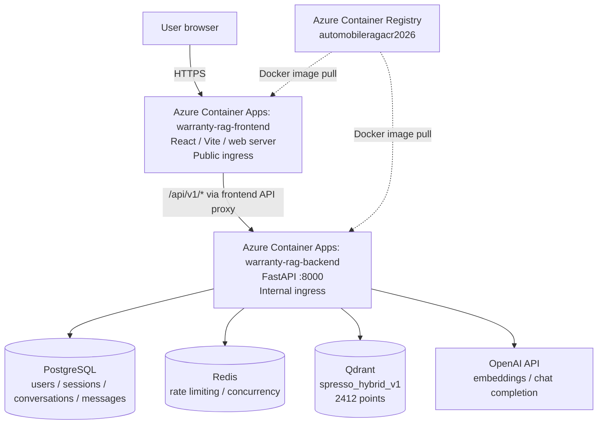
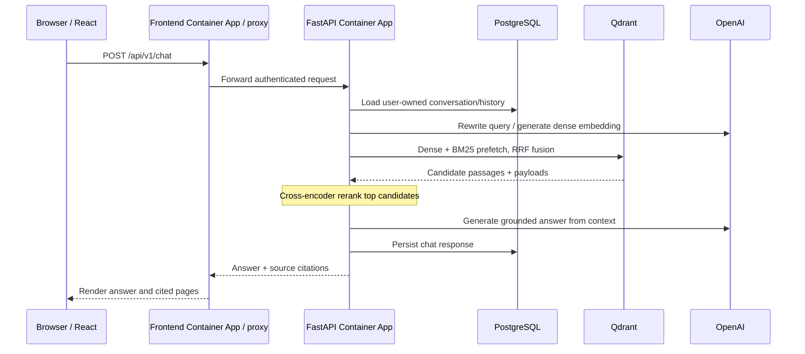
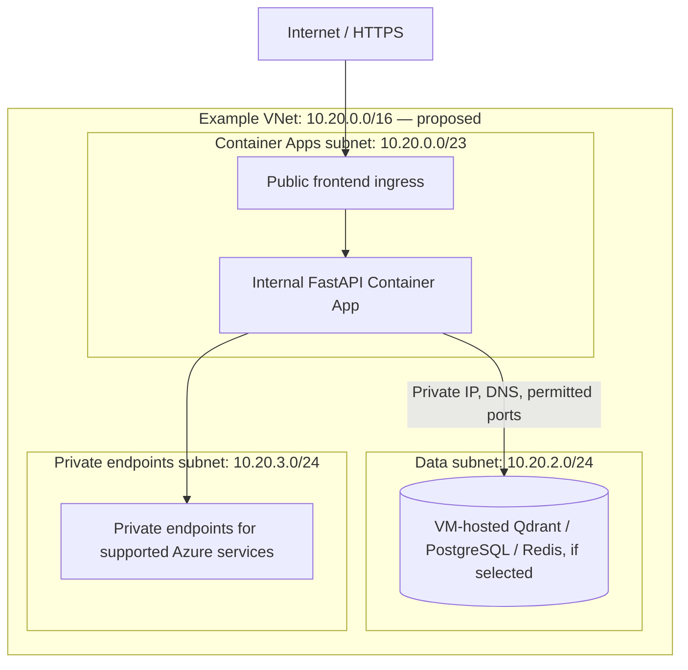

# S-Presso Enterprise RAG — Azure Deployment Architecture

**Documentation status:** 12 November 2026  
**Project:** Maruti Suzuki S-Presso owner's-manual RAG  
**Resource group:** `rg-automobile-rag-dev`  
**Azure region:** Central India

> **Evidence labels:** **Verified** = observed in deployment commands/tests; **Needs verification** = not yet confirmed; **Proposed** = future design, not currently deployed.

## 1. Deployed architecture (verified application-level flow)



This diagram shows logical service communication, **not** confirmed physical hosting for PostgreSQL, Redis or Qdrant. The frontend-to-backend reverse-proxy configuration was inferred from the successful browser API flow and should be confirmed from the frontend web-server configuration.

### Hosting inventory

| Component | Current information | Verification status |
|---|---|---|
| React frontend | Container App `warranty-rag-frontend`; public HTTPS | Verified |
| FastAPI backend | Container App `warranty-rag-backend`; internal ingress, port 8000 | Verified |
| Container Apps environment | `cae-automobile-rag-dev` | Previously used; inspect current state |
| Registry | `automobileragacr2026.azurecr.io` | Verified |
| Frontend image | `warranty-rag-frontend:v2` | Previously deployed |
| Backend image | `warranty-rag-backend:v3` | Previously deployed |
| Backend revision | `warranty-rag-backend--0000007` | Verified during troubleshooting |
| Qdrant collection | `spresso_hybrid_v1`, 2,412 points, dense + BM25 sparse | Verified |
| PostgreSQL | Accessible from backend; Alembic migrations applied | Verified service, hosting unconfirmed |
| Redis | Configured for backend use | Service location unconfirmed |
| Azure VM | Earlier deployment experiment | **Current purpose/status unconfirmed** |
| VNet and subnets | Not yet inspected | **Needs verification** |

**Public frontend URL:** https://warranty-rag-frontend.bravecoast-33edf5ab.centralindia.azurecontainerapps.io  
**Internal backend hostname:** `warranty-rag-backend.internal.bravecoast-33edf5ab.centralindia.azurecontainerapps.io`

## 2. Frontend hosting and ingress

1. A production React/Vite frontend is built into a Docker image.
2. The image is stored in Azure Container Registry.
3. Azure Container Apps runs the frontend container with **external ingress**, exposing a public HTTPS hostname.
4. A user opens the public URL, loads the React application, and signs in.
5. The frontend makes requests such as `POST /api/v1/auth/login`, `POST /api/v1/chat`, and `GET /api/v1/conversations`.
6. The frontend web-server/API proxy forwards these requests to FastAPI. **The exact proxy target and DNS configuration still need inspection.**

The browser does not need a directly accessible public backend endpoint when the frontend proxies the API requests.

## 3. Backend hosting and internal ingress

- The working FastAPI backend runs as the **`warranty-rag-backend` Azure Container App**, rather than on the earlier experimental VM.
- Its application listens on port `8000`.
- Internal ingress makes the backend reachable through the Container Apps environment's supported internal service routing, without directly exposing its endpoint publicly.
- The backend handles login/session management, persistent chat history, retrieval, reranking, generation and citations.
- Backend environment settings include `DATABASE_URL`, `REDIS_URL`, `QDRANT_URL` and `OPENAI_API_KEY`; the OpenAI environment variable references the Container Apps secret `openai-api-key`.

### Chat request sequence



## 4. Qdrant and the RAG pipeline

- Original collection: `spresso_manual_full`, **2,412** points, unnamed dense vectors of **1,536 dimensions** and **no sparse vectors**.
- The retrieval code required named vectors `dense` and `bm25` in collection `spresso_hybrid_v1`.
- Created a separate hybrid collection with `dense` (cosine distance, 1,536 dimensions) and `bm25` (sparse vector with IDF modifier).
- Migrated all 2,412 source points, preserving IDs and payloads, reusing existing dense embeddings and generating BM25 sparse vectors from stored chunk text.
- Query flow: query rewriting → OpenAI `text-embedding-3-small` → FastEmbed `Qdrant/bm25` → Qdrant dense/sparse prefetch → Reciprocal Rank Fusion → cross-encoder reranking → `gpt-4.1-mini` answer generation → citations.
- Verified retrieval returned warranty policy on page 8; full RAG response correctly gave **36 months or 100,000 km, whichever comes first**, with a source citation.

## 5. What is the VM used for?

### Earlier VM-based experiment

An earlier architecture involved a FastAPI backend on a VM and a React frontend on Container Apps. This is **not the verified working backend topology today**. The VM's current state and whether it hosts Qdrant, PostgreSQL, Redis or anything else must be checked.

A VM can be useful for custom system packages, persistent self-managed databases/vector stores, self-hosted models or GPU inference. Compared with Container Apps, it also requires more OS patching, availability, backup and security maintenance.

### Current verified hosting

**Both the frontend and backend run on Azure Container Apps.** Do not state in interviews that the live backend is on a VM unless the VM is independently confirmed to host another active backend instance.

## 6. VNet, private networking and ingress

### What we know

- Frontend: **external/public ingress**.
- Backend: **internal ingress**.
- The application works end to end through the frontend URL.
- The exact customer-managed VNet, subnet IDs, private DNS configuration, NSGs, VM network interface and database hosting are **not yet verified**.

Internal Container Apps ingress **does not by itself prove** that a customer-managed VNet was configured. Azure Container Apps provides environment networking and service discovery; verify the environment's VNet settings before drawing a physical network topology.

### Proposed enterprise VNet layout (not the current verified configuration)



The example address ranges are illustrative only. Real subnet size/delegation requirements depend on the Container Apps environment type and current Azure requirements.

### Secure networking implementation steps (proposed)

1. Inventory existing VNet/subnets, Container Apps environment, VM NICs and endpoints.
2. Choose non-overlapping VNet and subnet ranges.
3. Configure the Container Apps environment's supported VNet integration and subnet requirements.
4. Place self-hosted databases behind private IPs, or use managed services with private endpoints where supported.
5. Configure DNS resolution, NSGs/firewalls, and required outbound access.
6. Restrict inbound database/vector ports; expose only intended public HTTPS entry points.
7. Validate backend-to-data connectivity, frontend-to-backend proxying, authentication, TLS and failure behavior.
8. Review Azure resource changes carefully: some Container Apps environment networking choices cannot be modified in place and may require migration/recreation.

## 7. Deployment steps actually performed

1. **Build application:** React/Vite frontend; FastAPI backend; PostgreSQL authentication/chat persistence; Redis controls; Qdrant hybrid retrieval.
2. **Prepare Azure:** Use resource group `rg-automobile-rag-dev` in `centralindia`.
3. **Prepare ACR:** `automobileragacr2026` stores Docker images.
4. **Build/publish containers:** Backend `warranty-rag-backend:v3`; frontend `warranty-rag-frontend:v2`.
5. **Deploy Container Apps:** Frontend public ingress; backend internal ingress on port 8000.
6. **Connect frontend and backend:** Route `/api/v1/*` requests through the frontend's API proxy to the internal FastAPI service; verify exact proxy settings from deployed config.
7. **Set secrets/config:** `DATABASE_URL`, `REDIS_URL`, `QDRANT_URL`, and `OPENAI_API_KEY` secret reference.
8. **Initialize database:** Alembic migrations created users, conversations, messages, sessions and idempotency structures.
9. **Fix OpenAI authentication:** Correct invalid secret value and restart backend revision.
10. **Fix retrieval collection mismatch:** Create `spresso_hybrid_v1` and migrate 2,412 points with dense + BM25 sparse vectors.
11. **Verify retrieval and generation:** Hybrid retrieval found warranty text on page 8; local full pipeline returned cited answer.
12. **End-to-end test:** User confirmed the deployed chatbot works from the Azure frontend.

## 8. Challenges encountered and resolutions

| Challenge | Symptom | Resolution / lesson |
|---|---|---|
| Database schema missing | `relation "users" does not exist` during registration | Run Alembic migrations against deployed PostgreSQL; include migrations in release workflow |
| Alembic configuration issue | Temporary config lacked required logger sections | Create valid Alembic config and apply revisions through `4d1a13d8dfb3` |
| Invalid OpenAI secret | HTTP 401, literal `env:OPENAI_SECRET` treated as API key | Save raw API key in Container Apps secret; restart revision; never expose key in logs/chat |
| Missing hybrid collection | Qdrant 404: `spresso_hybrid_v1` not found | Create matching collection with named dense/BM25 vectors |
| Incompatible existing collection | `spresso_manual_full` had only unnamed dense vectors | Migrate source points into new hybrid schema without paying for dense re-embedding |
| Local Qdrant connectivity | `WinError 10061` connecting to `localhost:6333` | Check local Qdrant availability; distinguish local test failures from Azure backend |
| Azure exec command quoting | `SyntaxError` when passing nested quotes from Windows CMD | Use simpler shell commands or local inspection; account for CMD quoting |
| Container Apps environment provisioning | Earlier environment showed `ScheduledForDelete` | Verify resource state before deployment; do not assume environment is reusable |
| Secrets in Git history | GitHub push protection blocked earlier pushes | Remove/rotate exposed secrets and use environment/secret stores rather than commits |

## 9. Read-only Azure commands to verify physical network architecture

Run from **Windows CMD**. These commands query configuration and do not modify resources.

**Container Apps environment VNet settings:**

```cmd
az containerapp env show --name cae-automobile-rag-dev --resource-group rg-automobile-rag-dev --query "{Name:name,InfrastructureSubnet:properties.vnetConfiguration.infrastructureSubnetId,Internal:properties.vnetConfiguration.internal,StaticIP:properties.staticIp}" -o json
```

**Frontend ingress:**

```cmd
az containerapp show --name warranty-rag-frontend --resource-group rg-automobile-rag-dev --query "properties.configuration.ingress" -o json
```

**Backend ingress:**

```cmd
az containerapp show --name warranty-rag-backend --resource-group rg-automobile-rag-dev --query "properties.configuration.ingress" -o json
```

**VM inventory:**

```cmd
az vm list --resource-group rg-automobile-rag-dev --show-details --query "[].{Name:name,State:powerState,PrivateIP:privateIps}" -o table
```

**VNet inventory:**

```cmd
az network vnet list --resource-group rg-automobile-rag-dev --query "[].{Name:name,AddressSpace:addressSpace.addressPrefixes}" -o json
```

> These checks only list resources in the named resource group. A VM or VNet in another resource group will not appear; expand the search to the subscription if necessary.

## 10. Proposed next steps — not yet implemented

### Terraform infrastructure as code

- Define resource group, ACR, Container Apps environment, frontend/backend apps, ingress, identities, logging, and scaling.
- **Import existing resources** rather than blindly recreating them; inspect `terraform plan` before applying.
- Store Terraform state securely in a remote backend and protect credentials.

### CI/CD

- Lint/test → build container images → scan images → publish to ACR → deploy revision → run migrations carefully → smoke tests → staged rollout/rollback.
- Keep infrastructure changes and application releases controlled and auditable.

### Incremental document updates

```mermaid
flowchart LR
    PDF[New/revised PDF] --> Store[Blob Storage / intake]
    Store --> Extract[Extract text / OCR if needed]
    Extract --> Diff[Version + content-hash comparison]
    Diff --> Chunk[Chunk changed content]
    Chunk --> Emb[Dense + BM25 embeddings]
    Emb --> Validate[Retrieval / policy QA checks]
    Validate --> Upsert[Qdrant upsert / activate version]
    Upsert --> Chat[FastAPI RAG queries current approved docs]
```



- Add metadata: `document_id`, `version`, `effective_date`, `is_active`, `content_hash`.
- Use deterministic chunk IDs; update only changed chunks; archive/remove obsolete points safely.
- Ensure retrieval filters out superseded policy versions, preventing conflicting warranty answers.
- Support approval, rollback, monitoring, evaluation and audit logs.

### Operational readiness

- Configure autoscaling, metrics/alerts, tracing, structured logs, backups, recovery tests, security controls, cost budgets and load testing.
- Confirm PostgreSQL, Redis and Qdrant persistence/backup arrangements and physical hosting.

## 11. Interview explanation

> I deployed an automotive enterprise RAG application on Azure Container Apps. The React frontend uses public HTTPS ingress, while the FastAPI backend uses internal ingress. Frontend API requests are forwarded to FastAPI, which uses PostgreSQL for identity and conversation history, Redis for request controls, and Qdrant for dense-plus-BM25 hybrid retrieval with reciprocal rank fusion and cross-encoder reranking. We indexed 2,412 S-Presso manual chunks and generate grounded answers with source citations. I resolved production issues involving Alembic migrations, API-key secrets, Qdrant vector schema mismatches and connectivity. The next phases are Terraform, CI/CD, observability, scaling and versioned document ingestion. The VM and customer-managed VNet details are still being verified, so I distinguish those from the confirmed Container Apps hosting.
